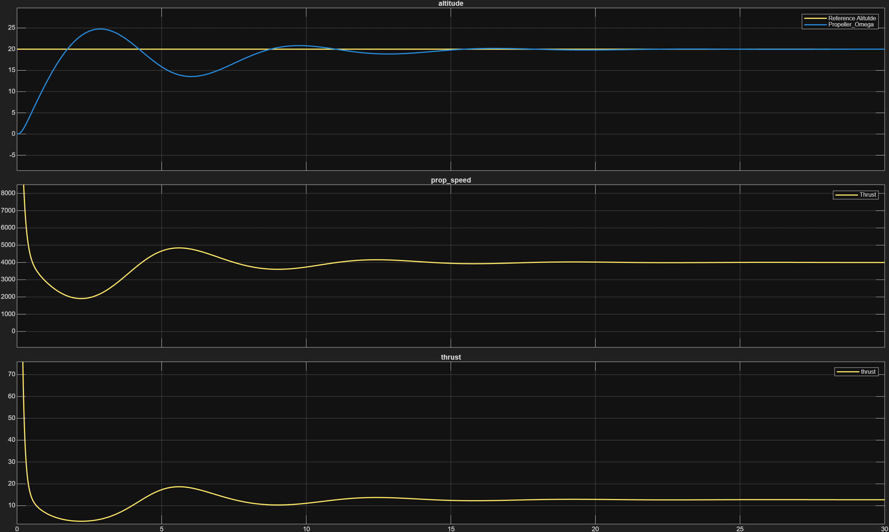
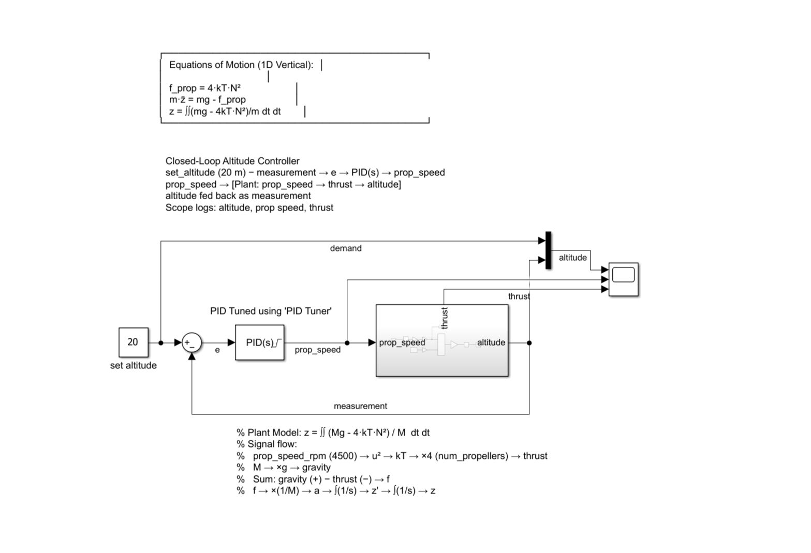

# Quadcopter Propeller Forces 

## Overview
This project models the vertical motion of a quadcopter by relating propeller rotational speed to the generated thrust force. The model is implemented in MATLAB/Simulink.

## 1. Equations of Motion

Assuming purely vertical motion and neglecting aerodynamic drag:

\[
m\ddot{z}=mg-f_{prop}
\]

The total propeller thrust for an X-configuration quadcopter is:

\[
f_{prop}=k_T(N_1^2+N_2^2+N_3^2+N_4^2)
\]

Assuming equal rotational speeds for all four propellers:

\[
f_{prop}=4k_TN^2
\]

where:
- \(m\) – Quadcopter mass
- \(g\) – Gravitational acceleration
- \(k_T\) – Propeller thrust coefficient
- \(N\) – Propeller rotational speed (RPM)
- \(z\) – Vertical position (altitude)

## 2. Simulink Model

The plant model takes propeller speed as input and calculates the resulting vertical acceleration, velocity, and altitude through successive integrations.

The model follows this sequence:

1. Propeller speed is squared.
2. Thrust is calculated using the propeller thrust coefficient and number of propellers.
3. Net force is calculated by subtracting thrust from gravity (with the chosen sign convention).
4. Newton's second law is used to obtain vertical acceleration.
5. Acceleration is integrated to obtain velocity and then altitude.

## 3. Results

## 4. Simulink Implementation

## Tools Used
- MATLAB
- Simulink

