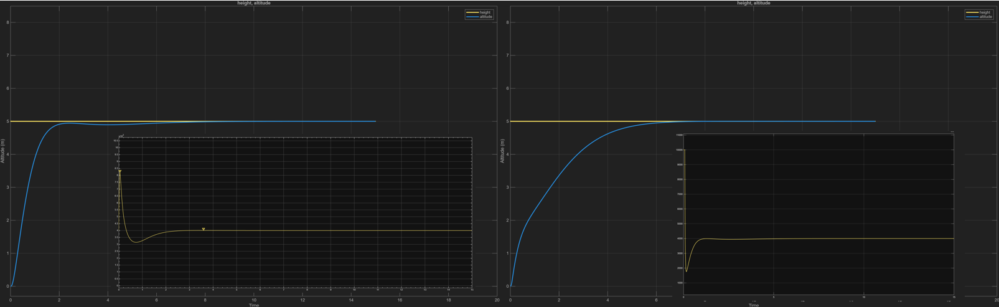
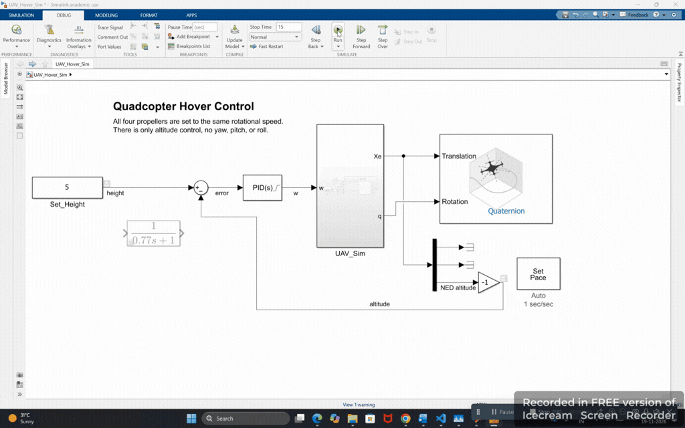
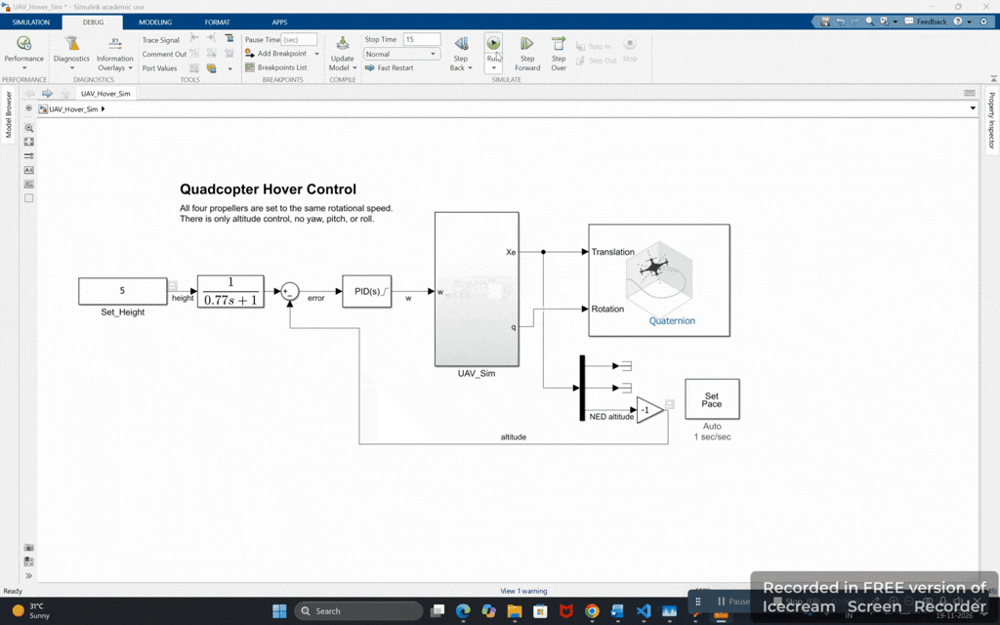

    # Quadcopter Altitude Hover Control: PID Design + Reference Prefilter

Altitude controller for a quadcopter in Simulink. I derived the plant by linearizing about hover, placed the PID poles analytically, and then found that a raw step command saturated the motors at t = 0 and gave a slow response. A reference prefilter fixed it.



| Without prefilter | With prefilter (τ = 0.77 s) |
|---|---|
|  |  |

## Result at a glance (5 m step)

| Setup | Altitude | Motor command w |
|---|---|---|
| PID only (p = 1, N = 15) | first rise stops at 4.6 m, dips to ≈ 3.3 m, reaches ≈ 5 m at ≈ 10 s | clipped at 10,000 rpm at t = 0, then **0 rpm for ≈ 0.5 s** |
| PID only, N = 100 | no overshoot, slow creep, ≈ 10 s | spike to 10,000 rpm, then ≈ 3,000 |
| PID + prefilter (p = 1, N = 30, τ = 1 s) | no overshoot, 95% at ≈ 2.5 s | peak ≈ 6,450, never touches a limit |
| PID + prefilter (p = 1.3, N = 50, τ = 0.77 s) | 95% at ≈ 1.9 s | peak ≈ 8,200 |

## 1. Plant model

Course model (up positive), four propellers each producing kT·ω²:

$$M\ddot z = 4k_T\omega^2 - Mg \qquad\Rightarrow\qquad \omega_h = \sqrt{\frac{Mg}{4k_T}}\ \ (\ddot z = 0)$$

Write the command as ω = ω_h + δω (δω is the distance from hover) and expand about hover.
Because the model is quadratic, the expansion is exact after two terms:


$$
\ddot z = \underbrace{\frac{8k_T\omega_h}{M}}_{K}\,\delta\omega + \frac{4k_T}{M}\,\delta\omega^2
$$

$$
K = \frac{2g}{\omega_h} \approx 0.0049\ \frac{\text{m/s}^2}{\text{rpm}}
$$

Linearizing means dropping the δω² term, which leaves a double integrator:

$$\frac{Z(s)}{\delta W(s)} = \frac{K}{s^2}$$

Check at δω = +100 rpm (ω = 4100): exact 0.4966 m/s², linear 0.4905 m/s². The linear model is good near hover.

The PID output is w = 4000 + δω. The integrator starts at the hover value, 4000 rpm
(ω_h ≈ 4000 rpm is read from the steady value of w in every run).

## 2. Saturation and anti-windup

| Setting | Value |
|---|---|
| Output limit | 0 to 10,000 rpm |
| Anti-windup | back-calculation, Kb = 1 |
| Integrator limit | 0 to 10,000 |
| Integrator initial value | 4000 (hover) |

Back-calculation pulls the integrator toward a value consistent with the clipped output:

$$\dot I = K_i\,e + K_b\,(u_{sat} - u)$$

Anti-windup limits the damage when the output clips, but it does not remove the cause.
In the PID-only runs the output clipped at t = 0 (and sat at 0 rpm for 5 m). With the prefilter, w stayed inside the limits, so the saturation logic was never triggered.

## 3. Closed loop and pole placement

Ideal parallel PID, C(s) = P + I/s + D·s, with the plant K/s²:

$$L(s) = \frac{K(Ds^2 + Ps + I)}{s^3}, \qquad 1 + L = 0 \;\Rightarrow\; s^3 + KD\,s^2 + KP\,s + KI = 0$$

The poles decide the response, and the coefficients are K·D, K·P, K·I, so choosing P, I, D is the same as choosing the poles. Pole placement runs it backwards: pick the poles, solve for the gains.
Triple pole at −p, (s + p)³ = s³ + 3p s² + 3p² s + p³:

$$D = \frac{3p}{K}, \qquad P = \frac{3p^2}{K}, \qquad I = \frac{p^3}{K}$$

This is a convenience, not an optimum. One speed knob, closed-form gains, no slow pole, no oscillation from the poles themselves. Its weaknesses are sensitivity to errors in K and no independent control of damping.

**Scaling law.** Substituting s = pσ cancels p³, so T(s) for any p is the p = 1 response with time compressed by p, $y_p(t) = y_1(pt)$. From the p = 1 step response
$y(t) = 1 - e^{-t}(1 - 2t + t^2/2)$: overshoot 20.6% (peak at t = 3 − √3 = 1.27 s),

$$t_s^{5\%} \approx \frac{2.7}{p}, \qquad t_s^{2\%} \approx \frac{5.6}{p}$$

| p | P | I | D | t_s (5%) |
|---|---|---|---|---|
| 0.8 | 391 | 104 | 489 | 3.4 s |
| 1.0 | 612 | 204 | 612 | 2.7 s |
| 1.2 | 881 | 352 | 734 | 2.3 s |

p = 1 to 1.2 matches the goal of settling in "a couple of seconds". The range was chosen for that, not derived.

## 4. PID only: what the simulation showed

N = 15, no prefilter:

| Run | p (P / I / D) | Step | Peak | Reaches target | w |
|---|---|---|---|---|---|
| A | 1.0 (612 / 204 / 612) | 1 m | 1.53 (53%) | ≈ 8 s | 10,000 at start, min ≈ 2,000 |
| B | 1.0 | 5 m | 4.6 on first rise, dips to ≈ 3.3 | ≈ 10 s | 10,000 at start, then 0 rpm |
| C | 1.2 (881 / 352 / 734) | 1 m | 1.55 (55%) | ≈ 7 s | 10,000 at start |
| D | 1.2 | 5 m | ≈ 4.96, dips to ≈ 3.9 | ≈ 8.5 s | 10,000 at start, then 0 rpm |

The linear design predicted 20.6% overshoot and 2.7 s. Raising p from 1 to 1.2 changed almost nothing.
A larger p means a bigger kick, so it saturates harder, while a smaller p saturates less but is slower.

**Cause.** A step makes the error jump to e₀, and the derivative term responds with a spike of size D·N·e₀ that decays as e^(−Nt) (about 1/N seconds). With D = 612 and N = 15 and a 5 m step that is ≈ 46,000 rpm against a 10,000 rpm limit, so w clips at t = 0.

**Sweeping N** (p = 1, 1 m step):

| N | Peak | Time to reach ≈ 0.97 | w at start |
|---|---|---|---|
| 15 | 1.53 (53%) | ≈ 8 s | spike to 10,000 |
| 30 | 1.14 (14%) | ≈ 7.4 s | spike to 10,000 |
| 100 | none | ≈ 10 s | spike to 10,000, then ≈ 3,000 |

Raising N removes the overshoot (the filter lag was adding it) but not the slow settling.

**One plausible explanation (not proven).** The linear design relies on the derivative kick to launch the drone. The actuator clips it, so the drone gets less push than the design assumed. After the kick, w falls back toward hover and the controller only recovers the remaining error slowly through the integrator.
That is the slow creep. Gain tuning alone cannot fix this; the cause is the step command saturating the actuator at t = 0.

## 5. Fix: reference prefilter

A first-order prefilter F(s) = 1/(τs + 1) on the setpoint, outside the loop, so the loop poles are unchanged. With e(0) = 0 there is no kick. The derivative term only sees the rate of change of the error, about A/τ, so the initial push is roughly D·A/τ ≈ 3,000 rpm for A = 5 m, τ = 1 s.

Choosing τ: a lower bound from saturation, D·A/τ < 6,000, which gives τ > ≈ 0.1·A. An upper bound from speed, since the filter itself needs ≈ 3τ to reach 95%. Rule of thumb τ ≈ 1/p.

**τ sweep** (p = 1, N = 30, 5 m):

| τ | Peak | w peak | Comment |
|---|---|---|---|
| 0.3 | 6.45 (29%) | 10,000 | aggressive, kick returns |
| 0.5 | 5.59 (12%) | ≈ 8,600 | overshoot, near the limit |
| 1.0 | none | ≈ 6,450 | clean |
| 2.0 | none | ≈ 5,270 | clean but slow (≈ 12 s to 4.98 m) |

With τ = 1 the last 1 to 2% (4.92 m to 5 m) still takes several seconds. This is a property of the loop. The design assumed an ideal derivative, but the N = 30 derivative filter shifts the closed-loop poles. The prefilter sits outside the loop and cannot change this.

**Faster: raise p and set τ ≈ 1/p** (5 m):

| p | P / I / D | N | τ | 95% time | Last 1% | w max |
|---|---|---|---|---|---|---|
| 1.0 | 612 / 204 / 612 | 30 | 1.0 | ≈ 2.5 s | ≈ 8 s | ≈ 6,450 |
| 1.3 | 1034 / 448 / 795 | 50 | 0.77 | ≈ 1.9 s | ≈ 6 s | ≈ 8,200 |
| 1.5 | 1376 / 688 / 917 | 50 | 0.67 | ≈ 1.7 s | ≈ 5.5 s | 10,000 (saturates) |

p = 1.3 is the better compromise. It saves about a second to 95% and a few seconds on the tail while keeping margin from the limit.

## Limitations and next steps

- Simulation only: no motor lag, sensor noise, delay or drag. Hover rpm (≈ 4000) is inferred from the simulation.
- τ should come from the vehicle's climb-rate limit on hardware: τ ≥ A / v_max. The best τ depends on the step size A.
- For an even smoother start, a second-order filter or a trajectory generator.

## Repository

```
model/      Simulink model (see Credits)
results/    Above details and GIFs
docs/       PID_Hover_Control_Design_notes.pdf - Handwritten Notes
```

Run: open the model 'UAV_Hover_Sim_Ninad'.

## Credits

The plant model animation block from an Online Course on "Introduction to Quadcopter Modeling & Simulation." by Pranav Lad and Dhruv Chandel. [https://github.com/MathWorks-Teaching-Resources/Quadcopter-Modeling-Simulation/tree/release#introduction-to-quadcopter-modeling--simulation]
My work: Hover dynamics and modeling, linearization, pole-placement design, the N and τ studies, the prefilter and the analysis.
